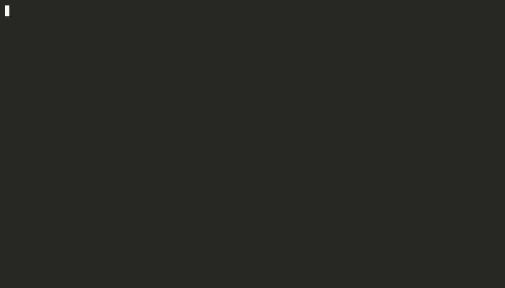

# Orpheus: High-Performance CLI framework for Go


[](https://github.com/agilira/orpheus/actions/workflows/ci.yml)
[](https://github.com/agilira/orpheus/actions/workflows/codeql.yml)
[](https://github.com/agilira/orpheus/actions/workflows/ci.yml)
[](https://github.com/agilira/orpheus/actions/workflows/ci.yml)
[](https://www.bestpractices.dev/projects/11276)
[](https://github.com/avelino/awesome-go)

Orpheus is a high-performance CLI framework designed to be super simple and **~10x faster** than Cobra and Kingpin (**60x** than urfave/cli), with `golang.org/x/term` as its only dependency outside the AGILira stack. Built on [FlashFlags](https://github.com/agilira/flash-flags) & [go-errors](https://github.com/agilira/go-errors), Orpheus provides a simple interface to create modern, secure, fast CLI apps similar to git.

## Live Demo

<div align="center">

A Git-like CLI with nested subcommands, flags and errors that carry hints ([examples/gitlike](examples/gitlike)):



</div>

**[Features](#features) • [Performance](#performance) • [Security](#security) • [Quick Start](#quick-start) • [Storage System](#storage-system) • [Observability](#production-observability) • [Examples](#examples) • [API Reference](#api-reference) • [Philosophy](#the-philosophy-behind-orpheus)**

## Features

- **Zero Third-Party Dependencies**: Built exclusively on AGILira libraries and Go extended standard library (`golang.org/x`)
- **Native Subcommands**: Git-style nested commands with automatic help generation
- **Pluggable Storage System**: Dynamic .so plugin loading for persistent storage (SQLite, Redis, File, custom providers)
- **Clean API**: Fluent interface for rapid development
- **Context Propagation**: `Run` is signal-aware by default; `RunContext` supports custom cancellation, deadlines, and tracing
- **Auto-completion**: Built-in bash/zsh/fish completion generation
- **Type-safe Errors**: Structured error handling with exit codes
- **Hot-swappable Commands**: Dynamic command registration and modification
- **Production Observability**: Zero-overhead logging, audit trails, tracing, and metrics interfaces
- **Metrics Backends**: Optional `metrics` package with Prometheus and JSON Lines implementations of `MetricsCollector`, standard library only
- **Terminal Output**: Optional `term` package with TTY and `NO_COLOR` detection, colors, aligned tables and a delayed spinner; every printed string is sanitized against escape-sequence injection
- **Interactive Prompts**: Built-in `Prompter` interface for user input (text, secrets, menus, confirmations) with terminal-safe masking
- **Secure by Design**: [Red-team tested](./security/security_test.go) and [fuzz tested](./security/fuzz_test.go)
- **Security Validation**: Including input sanitization, path traversal protection, and various security controls

## Compatibility and Support

Orpheus is designed for Go 1.25.9+ environments and follows Long-Term Support guidelines to ensure consistent performance across production deployments.

## Performance

Benchmark results comparing CLI framework performance:

```
AMD Ryzen 5 7520U with Radeon Graphics
BenchmarkOrpheus-8              2157322    609.2 ns/op      144 B/op     3 allocs/op
BenchmarkStdFlag-8              1256107   1354   ns/op      945 B/op    13 allocs/op
BenchmarkCobra-8                 307682   5826   ns/op     1680 B/op    24 allocs/op
BenchmarkKingpin-8               170030   5957   ns/op     1988 B/op    40 allocs/op
BenchmarkUrfaveCli-8              40959  38584   ns/op     8444 B/op   305 allocs/op

BenchmarkOrpheusSignalSetup-8     28756  42041   ns/op      513 B/op    12 allocs/op
```

**Scenario**: command parsing with 3 flags (string, bool, string) and handler execution — about 10x faster than Kingpin and Cobra, 60x faster than urfave/cli, at 3 allocations per dispatch.

`BenchmarkOrpheusSignalSetup` is measured separately and is not part of that comparison: it calls `Run`, which installs a signal-aware context, and registering OS signal handlers costs roughly 40µs. A CLI pays that once per process, and none of the other frameworks do it at all, so the comparison above uses `RunContext` — the same parse and dispatch without the setup.

**Reproduce benchmarks**:
```bash
cd benchmarks/
go test -bench=. -benchmem -benchtime=3s -count=3
```

**[Complete Performance Benchmarks →](./benchmarks/benchmark_test.go)**

## Security

Orpheus implements defense-in-depth security with comprehensive validation against CLI attack vectors.

**Protected Vectors:**
- Path traversal (case-insensitive, URL encoding, Windows device names)
- Shell command injection prevention (SQL and HTML stay free text: parameterized queries and escaping are the application's job)
- Command-line size limits via `ValidateArgs`
- Control character and null byte filtering
- Cross-platform consistency (Windows, Linux, macOS)

**Run Security Tests:**
```bash
make security      # Run security test suite
make fuzz          # Quick fuzz testing (30s)
make fuzz-long     # Extended fuzzing (5min)
```

## Quick Start

### Installation

```bash
go get github.com/agilira/orpheus@v1.12.0   # Latest stable release
# or simply
go get github.com/agilira/orpheus          # Always latest
```

### Basic Usage

```go
package main

import (
    "fmt"
    "log"
    "os"
    
    "github.com/agilira/orpheus"
)

func main() {
    app := orpheus.New("myapp").
        SetDescription("My awesome CLI application").
        SetVersion("1.0.0")

    // Add commands with fluent interface
    app.Command("start", "Start the service", func(ctx *orpheus.Context) error {
        fmt.Println("Service starting...")
        return nil
    })

    app.Command("stop", "Stop the service", func(ctx *orpheus.Context) error {
        fmt.Println("Service stopping...")
        return nil
    })

    // Run the application
    if err := app.Run(os.Args[1:]); err != nil {
        log.Fatal(err)
    }
}
```

### Context-aware Execution

`Run` installs Orpheus' default signal-aware context, so command handlers can
observe Ctrl-C/SIGTERM cancellation through `ctx.Context()` without extra setup:

```go
app.Command("sync", "Synchronize data", func(ctx *orpheus.Context) error {
    return syncData(ctx.Context())
})

if err := app.Run(os.Args[1:]); err != nil {
    log.Fatal(err)
}
```

Use `RunContext` when your application owns the lifecycle, needs a deadline, or
wants to provide a parent tracing context:

```go
runCtx, stop := signal.NotifyContext(context.Background(), os.Interrupt, syscall.SIGTERM)
defer stop()

app.Command("sync", "Synchronize data", func(ctx *orpheus.Context) error {
    return syncData(ctx.Context())
})

if err := app.RunContext(runCtx, os.Args[1:]); err != nil {
    log.Fatal(err)
}
```

### Auto-completion

Generate shell completion scripts for your CLI:

```bash
# Bash completion (add to ~/.bashrc)
./myapp completion bash > /etc/bash_completion.d/myapp

# Zsh completion (add to ~/.zshrc)
./myapp completion zsh > /usr/local/share/zsh/site-functions/_myapp

# Fish completion
./myapp completion fish > ~/.config/fish/completions/myapp.fish
```

### Subcommands

```go
// Create a command with subcommands
remoteCmd := orpheus.NewCommand("remote", "Manage remote repositories")

// Add subcommands using fluent API (v1.0.7+ - now works correctly)
remoteCmd.Subcommand("add", "Add a remote", func(ctx *orpheus.Context) error {
    name, url := ctx.GetArg(0), ctx.GetArg(1)
    fmt.Printf("Added remote: %s -> %s\n", name, url)
    return nil
}).AddFlag("--force", "Force add remote")

remoteCmd.Subcommand("list", "List remotes", func(ctx *orpheus.Context) error {
    fmt.Println("origin\thttps://github.com/user/repo.git")
    return nil
}).AddFlag("--verbose", "Show detailed information")

app.AddCommand(remoteCmd)

// Usage: ./myapp remote add --force origin https://github.com/user/repo.git
//        ./myapp remote list --verbose
```

> **Note on subcommands vs positional arguments:** if a parent command accepts
> both subcommands and free positional arguments (like `git stash [save]` vs
> `git stash pop`), the first non-flag argument is always matched as a
> subcommand. Design commands so that subcommand names do not collide with
> expected positional values. If a command needs both, use explicit subcommands
> for all variants (e.g., `stash save`, `stash pop`, `stash show`).

## Storage System

Orpheus provides a pluggable storage system that allows CLI applications to persist state using various backends through a unified interface:

```go
import (
    "log"
    "os"

    "github.com/agilira/orpheus"
    "github.com/agilira/orpheus/storage"
)

func main() {
    app := orpheus.New("myapp").
        SetDescription("CLI app with persistent storage").
        SetVersion("1.0.0")
    
    // Configure storage (supports SQLite, Redis, File, and custom providers)
    config := &storage.Config{
        Provider: "sqlite",
        Config: map[string]interface{}{
            "path": "./myapp.db",
        },
        EnableMetrics: true,
    }
    app.ConfigureStorage(config)
    
    // Commands can now use persistent storage
    app.Command("set", "Store a key-value pair", setCommand)
    app.Command("get", "Retrieve a value", getCommand)
    
    if err := app.Run(os.Args[1:]); err != nil {
        log.Fatal(err)
    }
}

func setCommand(ctx *orpheus.Context) error {
    store := ctx.Storage()
    if store == nil {
        return storage.ErrNotConfigured
    }
    
    key := ctx.GetArg(0)
    value := ctx.GetArg(1)
    
    return store.Set(ctx, key, []byte(value))
}

func getCommand(ctx *orpheus.Context) error {
    store, err := ctx.RequireStorage()
    if err != nil {
        return err
    }
    
    key := ctx.GetArg(0)
    value, err := store.Get(ctx, key)
    if err != nil {
        return err
    }
    
    fmt.Printf("Value: %s\n", string(value))
    return nil
}
```

**Key Features:**
- **Plugin Architecture**: Dynamic .so loading for storage providers
- **Zero Dependencies**: No external storage libraries required  
- **Security Hardened**: Input validation and plugin security checks
- **Production Ready**: Metrics, tracing, and audit logging integration
- **Provider Agnostic**: Unified interface for SQLite, Redis, File, and custom backends

**[Complete Storage Documentation →](./docs/STORAGE.md)**

### Interactive Prompts

Orpheus includes a built-in `Prompter` interface for interactive CLI workflows -- setup wizards, first-run configuration, guided input. Secrets are masked at the terminal level via `golang.org/x/term`.

```go
app := orpheus.New("myapp").
    SetDescription("Interactive CLI").
    SetVersion("1.0.0").
    SetPrompter(prompt.NewTerminal())

app.Command("setup", "Run first-time setup", func(ctx *orpheus.Context) error {
    p, err := ctx.RequirePrompter()
    if err != nil {
        return err
    }

    name, err := p.Ask("Your name:", "")
    if err != nil {
        return err
    }

    apiKey, err := p.AskSecret("API key:")
    if err != nil {
        return err
    }

    provider, err := p.Choose("LLM provider:", []string{"OpenAI", "Anthropic", "Ollama"})
    if err != nil {
        return err
    }

    confirm, err := p.Confirm("Save configuration?", true)
    if err != nil {
        return err
    }

    fmt.Printf("Name: %s, Provider: %d, Confirmed: %v\n", name, provider, confirm)
    _ = apiKey // use securely
    return nil
})
```

**Prompter methods:**

| Method | Purpose | Return |
|--------|---------|--------|
| `Ask(prompt, default)` | Free-text input with optional default | `(string, error)` |
| `AskSecret(prompt)` | Masked password/key entry | `(string, error)` |
| `Choose(prompt, options)` | Numbered menu selection | `(int, error)` (0-based) |
| `Confirm(prompt, defaultYes)` | Yes/no question | `(bool, error)` |

The `Prompter` interface is testable by design: inject a custom implementation for unit tests without touching a real terminal.

### Observability

Zero-overhead observability interfaces for production CLI applications:

```go
import "context"

// Configure observability (all interfaces are optional)
app := orpheus.New("myapp").
    SetLogger(myLogger).           // Structured logging
    SetAuditLogger(myAuditLogger). // Compliance and security
    SetTracer(myTracer).           // Distributed tracing
    SetMetricsCollector(myMetrics) // Performance metrics

app.Command("deploy", "Deploy application", func(ctx *orpheus.Context) error {
    // Structured logging
    if logger := ctx.Logger(); logger != nil {
        logger.Info(ctx.Context(), "Deployment started",
            observe.StringField("environment", "production"),
            observe.StringField("version", "v1.2.3"),
        )
    }

    // Audit trail
    if audit := ctx.AuditLogger(); audit != nil {
        audit.LogCommand(ctx.Context(), "deploy", ctx.Args, "demo-user")
        audit.LogAccess(ctx.Context(), "production", "deploy", true)
    }

    // Distributed tracing
    if tracer := ctx.Tracer(); tracer != nil {
        spanCtx, span := tracer.StartSpan(ctx.Context(), "deploy_operation")
        defer span.End()
        // ... use spanCtx for downstream operations
    }

    // Performance metrics
    if metrics := ctx.MetricsCollector(); metrics != nil {
        counter := metrics.Counter("deployments_total", "Total deployments", "env")
        counter.Inc(ctx.Context(), "production")
    }

    fmt.Println("Deployment completed")
    return nil
})
```

Ready-made collectors live in the optional `metrics` package (standard library only):

```go
import "github.com/agilira/orpheus/metrics"

prom := metrics.NewPrometheus(metrics.Options{})
app.SetMetricsCollector(prom)

ln, err := metrics.Listen(":9464") // no host: binds 127.0.0.1
if err != nil {
    return err
}
go metrics.Serve(ctx, ln, prom) // only /metrics, timeouts, DNS-rebinding guard on loopback

// or one JSON object per sample:
app.SetMetricsCollector(metrics.NewJSONL(file, metrics.Options{}))
```

Invalid or unbounded input (bad names, wrong label counts, NaN, too many
series) is dropped, counted in `orpheus_metrics_dropped_total{reason}` and
reported to `Options.OnError`; the collectors never panic.

**Performance**: 0.24 ns/op and no allocation when not configured; when configured, no measurable difference per dispatch — the cost is whatever your own logger, tracer or collector does

**[Complete Observability Guide →](./docs/OBSERVABILITY.md)**

**[Complete Examples →](./docs/EXAMPLES.md)**

## The Philosophy Behind Orpheus

Orpheus's lyre was no ordinary instrument. It could make rivers pause mid-flow, convince stones to dance, and move even Hades and Persephone to tears. When the great musician played, the impossible became inevitable—not through force, but through the pure beauty of perfect harmony.

Yet Orpheus understood something profound: true power lay not in complexity, but in elegant simplicity. Each note served a purpose, each silence held meaning. His melodies moved the world through perfect clarity of intent, never through force or intricacy.

Like the mythological master whose music could open the gates of Hades itself, Orpheus, transforms the cacophony of human commands into pure, executable harmony, making the complex dance between intention and fulfillment beautifully simple.

### Packages

| Import path | Contents |
|---|---|
| `github.com/agilira/orpheus` | App, Command, Context, help, completion |
| `github.com/agilira/orpheus/errs` | Error, the `ErrCode*` codes and their constructors |
| `github.com/agilira/orpheus/observe` | Logger, AuditLogger, Tracer, MetricsCollector, Field |
| `github.com/agilira/orpheus/storage` | Storage, Config, the plugin manager, storage errors |
| `github.com/agilira/orpheus/security` | InputValidator, ValidateSecurePath, file permission checks |
| `github.com/agilira/orpheus/prompt` | Prompter and its terminal implementation |
| `github.com/agilira/orpheus/metrics` | Prometheus and JSON Lines collectors |
| `github.com/agilira/orpheus/term` | Terminal capabilities, colors, tables, spinner |

The v1.11.0 import paths `pkg/orpheus`, `pkg/metrics` and `pkg/term` keep
the same API: their names are aliases of the types above, so code using
them compiles unchanged and values pass freely between the two paths.

### Core Components

- **App**: Main application container with command routing
- **Command**: Individual command with handler and flags
- **Context**: Execution context with arguments and flags
- **Prompter**: Interactive input interface (text, secrets, menus, confirmations)
- **Errors**: Type-safe error system with exit codes
- **Completion**: Auto-completion system for multiple shells
- **Observability**: Optional interfaces for logging, audit trails, tracing, and metrics

## Testing

```bash
# Run all tests
go test ./... -v

# Run with coverage
go test ./... -cover
```

## Examples

**[Complete Examples →](./docs/EXAMPLES.md)**

**Practical implementations:**
- **[GitLike Demo](./examples/gitlike/)** - Git-style CLI with subcommands and JSON persistence
- **[File Manager](./examples/filemanager/)** - Advanced file operations with completion
- **[Enhanced Errors](./examples/enhanced-errors/)** - Advanced errors handling
- **[Observability](./examples/observability/)** - Production-ready logging, audit trails, and metrics
- **[Storage System](./examples/storage/)** - Persistent storage
- **[Basic Example](./examples/basic/)** - Simple usage patterns and command structures

## API Reference

**[Complete API Reference →](./docs/API.md)**

## License

Orpheus is licensed under the [Mozilla Public License 2.0](./LICENSE.md).

---

Orpheus • an AGILira library
